# BitTV

A custom home screen (launcher) for Google TV, built for a TCL 55C6K. It replaces the stock Google TV home with a
faster, ad-free screen: your apps on the left, titles from the services you actually have, unified search across
them, a live Spotify card and news, and quick access to casting and HDMI inputs. Native Kotlin + Jetpack Compose for
TV; all navigation is designed for the D-pad remote.

All screenshots below were taken on the TV itself.

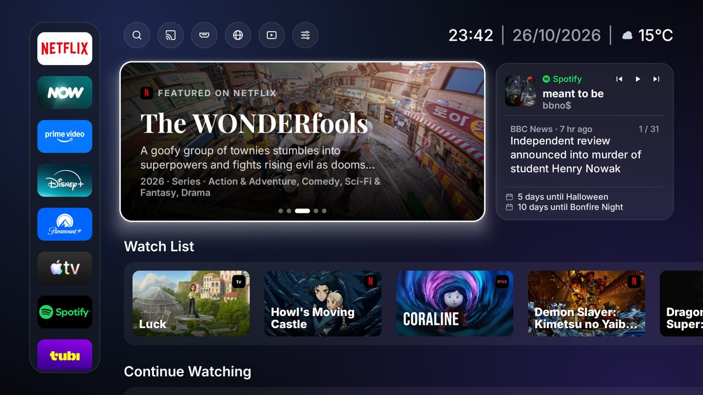

---

## Features

### Home
The top bar holds the shortcuts (Search, Cast, Inputs, Browser, Media, Settings) and the clock, date and live weather
(Open-Meteo). Below it:

- **Banner** — five featured titles from your apps, changing every 7 seconds; Down focuses its dots, where Left/Right
  pick a slide by hand. OK opens the title's page.
- **App bar** (left) — your apps, with each app's own TV artwork. Hold **OK** on an app to lift it, **Up/Down** to
  move it, **OK** or **Back** to drop it. Apps not installed show a download badge and offer the Play Store.
- **Spotify card** — what's playing, with back / play-pause / next controls.
- **News carousel** — headlines from BBC News, NASA, Ars Technica, Guardian Science, ScienceDaily, Smithsonian, NPR
  and ESA. The story changes every 7 minutes (sites take turns); focus the card and press **Right/Left** to flip
  through all of them (`2 / 31`), **OK** opens the one on show in the browser.
- **The day** — countdowns to upcoming dates (Halloween, Bonfire Night…).

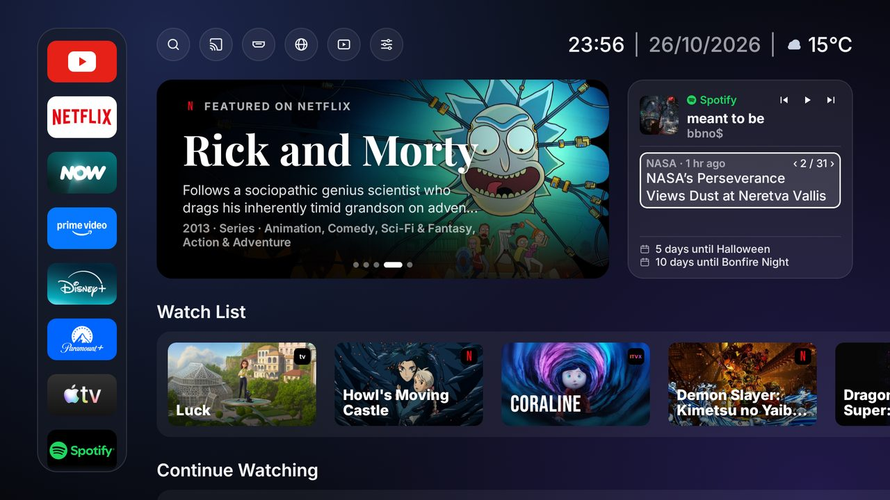

### Rows
Home has up to 20 rows, each filled from the services installed on the TV:

Watch List · Continue Watching · Action & Adventure · Comedy · Crime & Mystery · Drama · Science Fiction · Fantasy ·
Horror · Romance · Thriller · Biographical & Historical · Animation · Documentary · Sitcom · Procedural / Cop Show ·
Anthology Series · Limited Series / Miniseries · Dall'Italia · Free to watch

- **One title, one row.** A title never appears in two rows, nor in a row when it is already in the banner, the
  Watch List or Continue Watching. The narrowest kinds choose first (Sitcom before Comedy, Dall'Italia before Drama),
  cartoons stay in Animation, and a kind with fewer than 3 titles is left out.
- **Dall'Italia** is made-in-Italy titles (by original language) on any of your apps; **Free to watch** is Tubi,
  ITVX, La7 and RaiPlay.
- **Rotation** — every half hour the rows and banner draw a fresh selection from the best-rated titles.
- **Smooth scrolling** — a row's posters load only once the page has been still for a moment, so holding Down glides
  without a burst of image decoding.

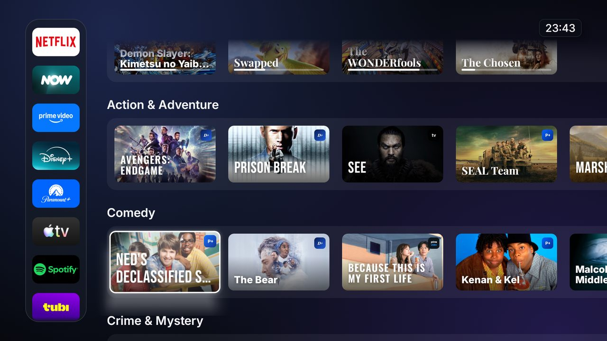

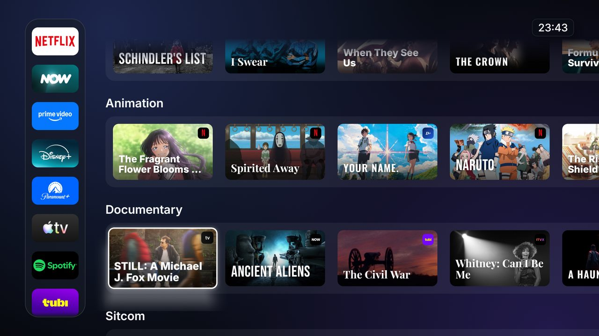

**Rearranging rows** works like the app bar: hold **OK** on any tile, move the whole row with **Up/Down**, then
**OK** or **Back** to place it. The order is saved.

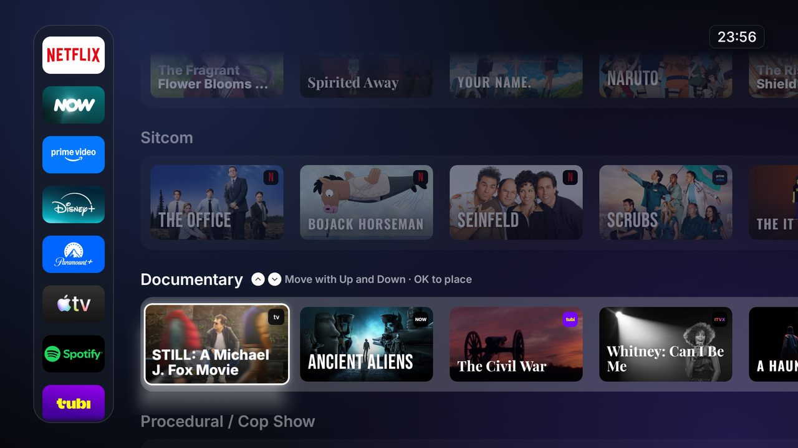

### Inputs
The HDMI button opens a dropdown of what's plugged into the TV, by the name the device reports (e.g. PlayStation 5,
with its port), then the remaining ports. Reading the list asks the devices nothing, so nothing is woken or switched;
**OK** switches the TV to that input. (The TV doesn't report which ports have a cable in, so ports whose device sends
no name are all listed, marked "No name reported".)

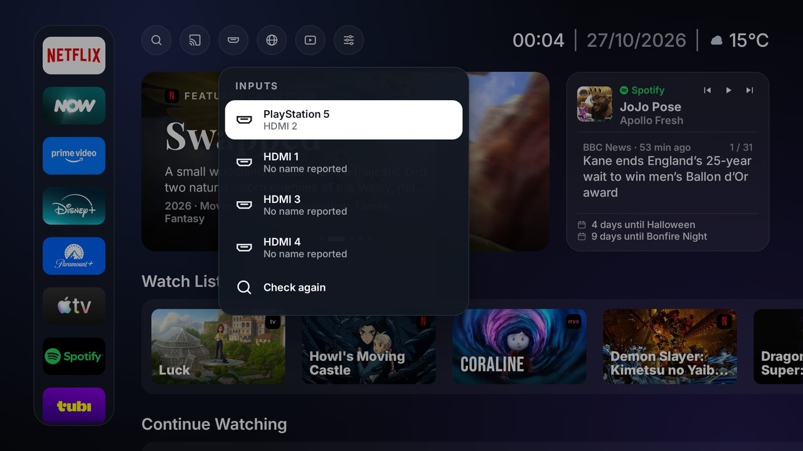

### Cast
The Cast button lists phones and computers on the Wi-Fi that can cast or mirror to the TV (AirPlay, Google Cast), and
OK on one shows the one step to take on that device. Miracast and T-Cast mirroring are on too.

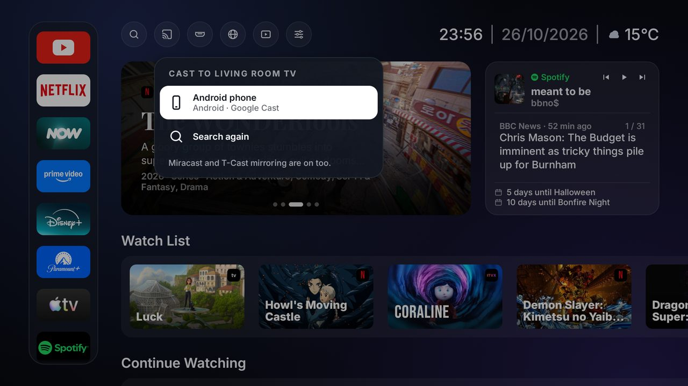

### Search
Opens with focus on **Speak** (voice search with the remote's mic); the on-screen keyboard is below it. Results come
from the downloaded catalogue instantly and from TMDB a moment after typing stops, split into two columns:

- **Included** — on the services you have.
- **Purchase** — on a service you don't have, to rent or buy (in Prime Video or Apple TV), or elsewhere (e.g.
  Crunchyroll); each tile says how.

**Similar Content** underneath is led by TMDB's recommendations for the top match.

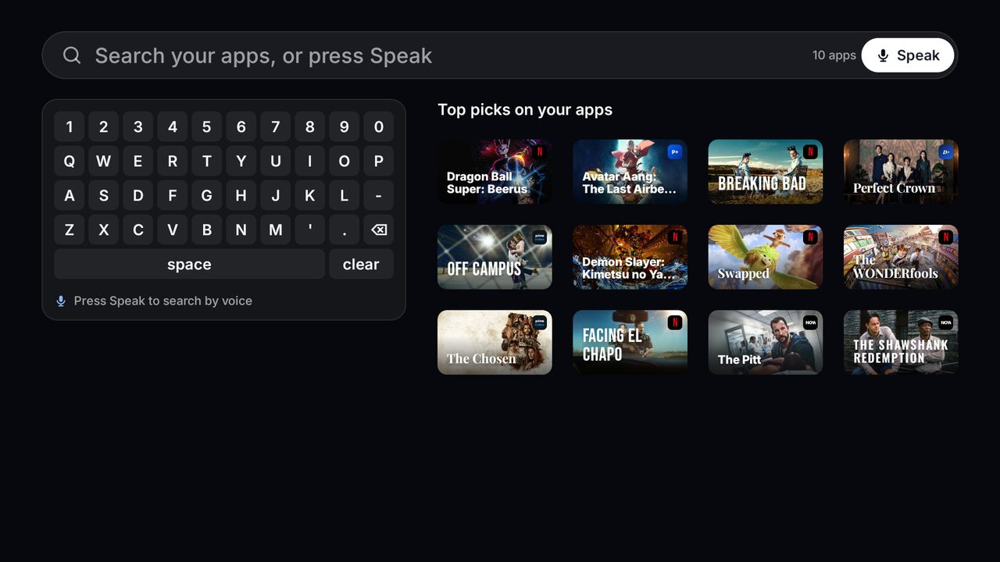

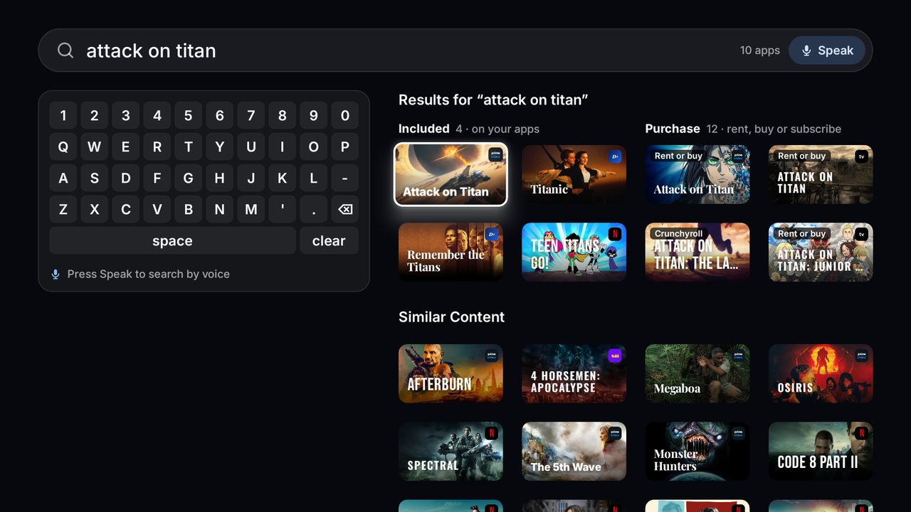

### Title page
Play (or Resume) opens the title straight in its app — its own page where the app supports it, otherwise the app's
search for it. Watch List saves it to Home. Below, Similar Content shows titles on your apps that share its genres. For
a title not on your subscriptions the button says "Open in …" or "Rent or buy on …", and lists where else it streams.

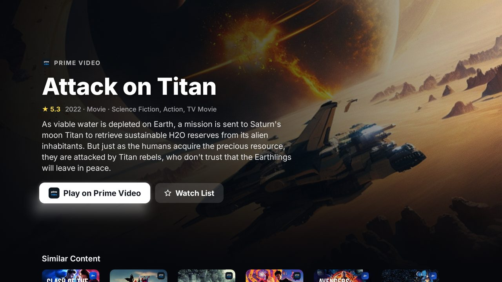

### Settings
Animations, overscan guides, replay the boot animation, reset the Watch List, a guide to the remote's shortcuts, and
the TV's own settings. **Apps on Home** lists every app on the TV with a switch to show it on the app bar; apps
installed later appear there by themselves.

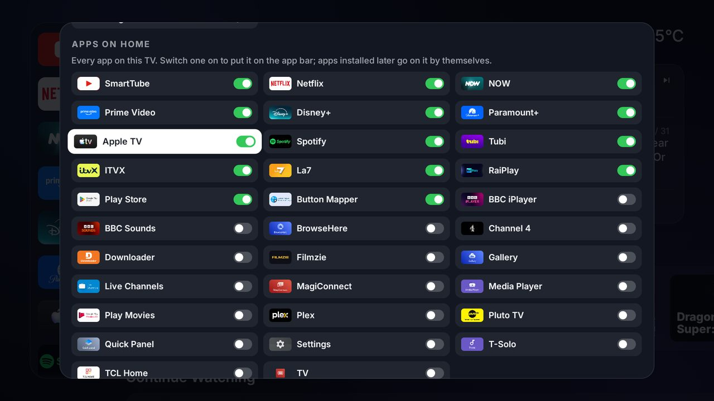

### Also
- **Boot animation** when BitTV starts or the TV wakes; any key skips it.
- **Home button** — an accessibility helper makes the remote's Home button open BitTV (TV Settings → Accessibility
  → BitTV Home button).
- Speed: on the TV, 91–96 % of scroll animation frames on time (P50 22 ms); see [docs/perf.md](docs/perf.md).

---

## Building and installing

Requirements: JDK 21, the Android SDK, and a TMDB API key (free) for the real catalogue — without one BitTV runs on a
built-in demo catalogue.

```bash
# android/local.properties (never committed)
sdk.dir=/path/to/Android/Sdk
tmdb.apiKey=<TMDB v3 key or v4 read access token>

cd android
./gradlew :app:assembleRelease                 # the app
./gradlew :app:testDebugUnitTest               # JVM tests
ANDROID_SERIAL=emulator-5554 ./gradlew :app:connectedDebugAndroidTest   # UI tests on the Google TV emulator
```

To put it on the TV (developer options → wireless debugging), see [tools/tv/README.md](tools/tv/README.md):
`install.sh` installs it and makes it the home screen, `debloat.sh` disables the stock apps listed in `debloat.txt`,
`restore.sh` undoes both. Every script only prints what it would do until you add `--apply`.

```bash
adb connect <tv-ip>:5555
adb -s <tv-ip>:5555 install -r android/app/build/outputs/apk/release/app-release.apk
```

After reinstalling, turn **BitTV Home button** off and on again in the TV's Accessibility settings.

TV-specific findings (why Google TV's own launcher must stay enabled, HDMI-CEC behaviour, deep links per app) are in
[docs/tv-profile.md](docs/tv-profile.md).

## Project layout

```
android/app/src/main/java/com/bittv/home/
  ui/         home (rows, banner, app bar, menus), search, details, settings, boot
  data/       catalogue (TMDB), preferences, app order and visibility
  search/     local matching and Similar Content
  platform/   apps, HDMI inputs, Spotify session, Home-button helper, deep links
  news/ weather/ today/
tools/tv/     install, debloat and restore scripts for the TV
docs/         requirements, TV profile, performance notes
```

Data: titles and artwork from [TMDB](https://www.themoviedb.org/) (where-to-watch data by JustWatch); weather from
[Open-Meteo](https://open-meteo.com/). This product uses the TMDB API but is not endorsed or certified by TMDB.
